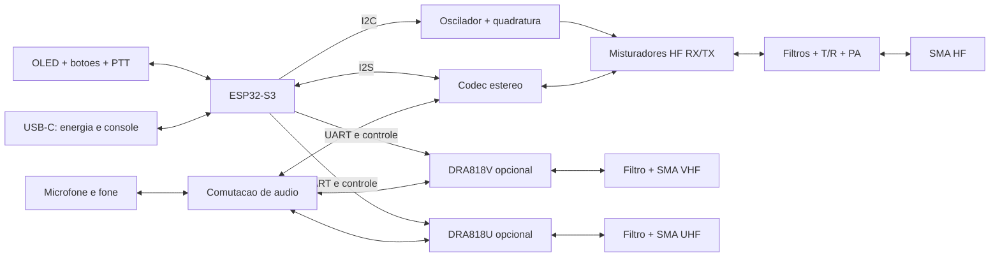

# SkyWave SDR

**Rádio portátil open source com ESP32-S3, OLED, PTT, acesso USB e módulos HF/VHF/UHF.**
Prioridade: baixo custo, montagem incremental e operação autônoma, sem computador
Linux dentro do aparelho. Projeto independente de Daniel Marques.

> **D0: arquitetura e firmware de interface. Ainda não recebe nem transmite RF.**
> A frequência na tela é uma prévia. Não há PCB, cadeia de áudio/RF, DSP de voz,
> autonomia ou potência validados. Esta versão não é um projeto de fabricação.

## Requisitos e decisões

- ESP32-S3 como controlador e processador de banda-base do futuro módulo HF.
- OLED I²C 128×64: SH1106 como referência; SSD1306 como alternativa econômica.
- PTT lateral, botões de sintonia/banda, microfone, fone e alto-falante previstos.
- USB-C para alimentação, programação e console; SMA por módulo de RF.
- HF SDR e expansões VHF/UHF separadas, com apenas um transmissor ativo por vez.
- Compra incremental: interface → um módulo RF → outras bandas → bateria/gabinete.
- Formato portátil inspirado na praticidade do Flipper Zero; sem afiliação ou
  compatibilidade de firmware prometida.

O planejamento aproveita a separação entre hardware, firmware, interface e energia
estudada no SkySentinel. Todos os arquivos aqui são originais; não foram publicados
código, esquemas, memórias ou dados privados daquele projeto.

## SDR e compromisso de custo

| Módulo | Arquitetura proposta | Situação |
| --- | --- | --- |
| HF: 40/20/15/10 m | Misturadores I/Q, codec estéreo I²S e DSP no ESP32-S3 | RF/DSP pendentes |
| VHF: 2 m | DRA818V opcional, voz FM, controle UART | Candidato; driver pendente |
| UHF: 70 cm | DRA818U opcional, voz FM, controle UART | Candidato; driver pendente |
| VHF/UHF SDR | Conversores para FI e cadeia I/Q, ou módulo com I/Q acessível | A projetar e cotar |

**A configuração econômica é híbrida.** Os DRA818 processam FM internamente e não
expõem amostras I/Q ao ESP32. Não equivalem a VHF/UHF SDR aberto. Para SDR também
nessas bandas será necessário desenvolver a expansão I/Q; isso permanece no
escopo, mas não está atendido na D0. ESP32 + CC1101/LoRa também não substitui uma
cadeia SDR de banda-base aberta.

Os intervalos no firmware são perfis de interface, não autorização para transmitir
ou plano regulatório. Não há promessa de cobertura contínua de HF a UHF,
potência definida ou recepção e transmissão simultâneas.

## Arquitetura proposta



HF RX: pré-seletor → detector em quadratura → filtro de banda-base → ADC estéreo
→ DSP → áudio. HF TX: microfone → ADC → DSP SSB → DAC I/Q → modulador em quadratura
→ driver/PA → filtro passa-baixas. Si5351 e TLV320AIC3204 são candidatos; oscilador,
fase/divisor, misturadores, amplificação e filtros ainda exigem projeto e medição.

48 ksample/s em banda-base é um ponto inicial de engenharia, não desempenho
demonstrado. RX usa os dois ADCs para I/Q e DAC para áudio; TX usa ADC para microfone
e os dois DACs para I/Q. Roteamento analógico e configuração do codec mudam por
estado. SSB, AGC, filtros, calibração I/Q e supressão de portadora não existem ainda.

VHF/UHF econômicos usam áudio analógico; UART configura o módulo. Níveis lógicos,
alimentação, drivers PTT/enable, isolamento e filtragem precisam de esquema próprio.
A porta de expansão interna ainda não tem pinout elétrico definido.

## Firmware disponível

- C++17, Arduino sobre ESP-IDF, PlatformIO e duas variantes de display.
- Perfis HF 7/14/21/28 MHz, VHF 144 MHz e UHF 430 MHz; modos exibidos LSB/USB/FM.
- Botões com debounce, console USB, watchdog e interface OLED.
- Intertravamentos PTT, timeout de 30 s, invalidação após sintonia e exigência
  de soltar PTT depois de falha. Testes de limites e wrap do relógio.
- Sem backend RF: mostra `PREVIEW - NO RF`; pressionar PTT mostra `TX BLOQUEADO`.
  Nenhum GPIO de transmissão é acionado.

### Compilar e testar

```bash
python3 -m venv .venv
. .venv/bin/activate
pip install platformio==6.1.18
pio run -e esp32s3_oled -e esp32s3_ssd1306
mkdir -p build
g++ -std=c++17 -Wall -Wextra -Werror -pedantic \
  -Ifirmware/include tests/radio_test.cpp -o build/radio_test
./build/radio_test
```

Para uma bancada própria com ligações conferidas:

```bash
pio run -e esp32s3_oled -t upload
pio device monitor -b 115200
```

O alvo usa DevKitC-1 N8, sem depender de PSRAM. Variantes N8R8 precisam de
conferência antes de ativar PSRAM. Nenhum equipamento foi gravado ou ensaiado
pelo desenvolvimento D0. Compilar não demonstra funcionamento físico.

Validação de 12/10/2026: ambas as variantes compiladas sem avisos no log;
testes nativos passaram com AddressSanitizer e UndefinedBehaviorSanitizer.
Cada build reportou 19.168 bytes de RAM estática e 285.313 bytes de flash.
Esses números excluem heap/pilhas de execução e a futura cadeia DSP/RF.

### Ligações propostas da interface D0

Fonte única: [`firmware/include/pins.h`](firmware/include/pins.h).
Estas ligações são para uma bancada SkyWave separada.

| Sinal | GPIO / ligação |
| --- | --- |
| OLED SDA / SCL | 8 / 9; 100 kHz, endereço 0x3C |
| PTT | 4; botão normalmente aberto para GND |
| Sintonia − / + | 5 / 6; botões para GND |
| Próxima banda | 7; botão para GND |
| USB nativo D− / D+ | 19 / 20; usar o conector da placa |
| OLED alimentação | Módulo compatível com 3,3 V e pull-ups em 3,3 V |
| RF / codec / PA | Não atribuídos |

USB-C é requisito do produto: conferir o conector da revisão da DevKit comprada.
A placa final exigirá circuito próprio de USB-C/CC/ESD e alimentação. Não usar
GPIOs de USB, boot ou flash/PSRAM para periféricos por inferência.

Console: `?` informa estado, `+`/`-` alteram frequência, `b` muda banda.
Não existe comando remoto para iniciar transmissão.

## Hardware, energia e custo

[`hardware/bom.csv`](hardware/bom.csv) lista blocos e candidatos; não é uma BOM de
fabricação. [`hardware/sources.json`](hardware/sources.json) registra fontes e
hashes de documentos obtidos. PDFs de terceiros não são redistribuídos sob MIT.

A bancada inicial usa USB e fones, sem bateria própria ou gabinete industrial.
O aparelho final prevê microfone, áudio, PTT, antenas removíveis, USB-C e acesso
interno de manutenção. Modelos de conectores dependem do esquema elétrico.

**Custo final não cotado.** Valores ficam vazios na BOM até haver cotação rastreável,
incluindo frete, filtros, conectores e fabricação. A estratégia é montar primeiro
a interface, depois apenas um módulo de RF, expandindo sem comprar tudo de uma vez.

Antes de escolher bateria, medir RX, DSP e TX, picos, eficiência e aquecimento.
Carregador, proteção e power-path são outra etapa. Não alimentar módulos RF pelo
regulador 3,3 V da DevKit. A autonomia de um registrador não se transfere a um rádio.

## Etapas e critérios de aceite

1. **Interface:** compilar ambas as telas e ensaiar OLED, PTT e USB no ESP32.
2. **HF RX:** fechar codec/LO/quadratura/filtros; implementar I²S/DSP; medir
   ruído, rejeição de imagem e processamento sem perder blocos.
3. **HF TX:** implementar SSB e T/R; medir espectro, potência e espúrios em
   carga de 50 Ω antes de operar com antena.
4. **VHF/UHF FM:** esquemas, energia, UART com resposta/timeout, áudio, filtros
   e intertravamento físico de um único transmissor.
5. **VHF/UHF SDR:** projetar conversão/IF, cotar e implementar cadeia I/Q aberta.
6. **Portátil:** bateria, autonomia medida, gabinete, ergonomia, conectores,
   coexistência eletromagnética e revisão para fabricação.

Operação RF deve observar as autorizações e condições aplicáveis à faixa e ao
operador. O firmware não implementa plano regulatório brasileiro. D0 não é um
equipamento homologado ou projeto liberado para fabricação.

## Contribuir e licença

Abra issue e envie PR com teste ou evidência de bancada. Use Conventional Commits.
Registre fontes/revisões dos componentes, separando hipótese, simulação e medição.
Não publique credenciais e não trate compilação como ensaio RF.

Código e arquivos originais: [MIT](LICENSE). Dependências, módulos e datasheets
mantêm suas licenças. MIT não relicencia hardware comercial nem firmware de módulos.

### Fontes primárias

- [ESP32-S3](https://www.espressif.com/sites/default/files/documentation/esp32-s3_datasheet_en.pdf)
- [USB ESP32-S3](https://docs.espressif.com/projects/esp-usb/en/latest/esp32s3/usb_device.html)
- [TI TLV320AIC3204](https://www.ti.com/product/TLV320AIC3204)
- [Skyworks Si5351](https://www.skyworksinc.com/-/media/SkyWorks/SL/documents/public/data-sheets/Si5351-B.pdf)
- [Dorji DRA818V](https://www.dorji.com/docs/data/DRA818V.pdf)
- [Dorji DRA818U](https://www.dorji.com/docs/data/DRA818U.pdf)
- [U8g2](https://github.com/olikraus/u8g2)
