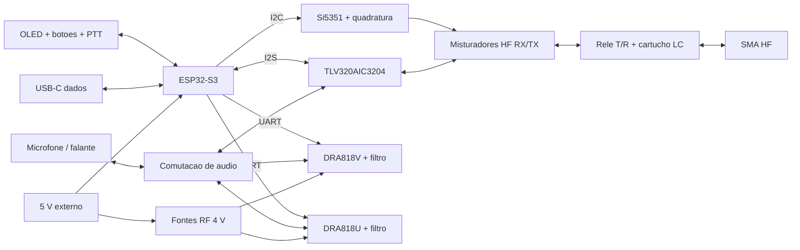

# SkyWave SDR

**Transceptor modular open source com ESP32-S3, OLED, PTT e acesso USB.**
Projeto de Daniel Marques, com prioridade para baixo custo e montagem incremental.


A revisão **D1** inclui circuitos, oito projetos KiCad, seleção de componentes,
simulações, modelos STEP e gabinete paramétrico em STL. É um protótipo de engenharia:
nenhuma placa foi fabricada ou ensaiada fisicamente. O firmware disponível ainda é
de interface e mantém a transmissão bloqueada, pois drivers RF/DSP estão pendentes.

## Abrir o projeto

- **[Circuito, PCB, BOM, ligações e testes D1](hardware/d1/README.md)**
- [Esquemas e placas KiCad editáveis](hardware/d1/ecad)
- [PDFs dos esquemas e curvas dos filtros](hardware/d1/plots)
- [Montagem 3D STEP](hardware/d1/cad/skywave_d1_assembly.step)
- [Base STL](hardware/d1/cad/enclosure_base.stl) e [tampa STL](hardware/d1/cad/enclosure_lid.stl)
- [Relatórios ERC/DRC](hardware/d1/reports/checks.json), [simulações](hardware/d1/reports/simulation.json)
  e [geometria](hardware/d1/reports/mechanical.json)

## Arquitetura

| Bloco | Implementação D1 |
|---|---|
| Controle | ESP32-S3-WROOM-1-N8, OLED SH1106/SSD1306, botões e PTT físico |
| Acesso | USB-C de dados/console, GPIO19/20; alimentação externa regulada de 5 V |
| HF 40/20/15/10 m | Codec TLV320AIC3204, Si5351A, quadratura, misturadores I/Q RX/TX e filtros intercambiáveis |
| VHF 2 m | DRA818V, FM analógica controlada por UART, fonte e filtro próprios |
| UHF 70 cm | DRA818U, FM analógica controlada por UART, fonte e filtro próprios |
| Áudio | Eletreto externo, comutação analógica, LM386 e saída para falante de 8 Ω |
| Gabinete | Montagem de bancada 164 × 120 × 74 mm; miniaturização posterior |

**A versão econômica é híbrida.** HF tem arquitetura SDR I/Q; DRA818 VHF/UHF não
expõem amostras I/Q e não são SDR aberto. A expansão I/Q VHF/UHF continua planejada.
HF D1 é um excitador de baixo nível, sem PA. Nos DRA, H/L aterrado seleciona potência
nominal de 0,5 W; potência, sensibilidade e emissões não foram medidas neste projeto.



O planejamento aproveitou a separação entre hardware, firmware, interface e energia
estudada no SkySentinel. Este repositório é independente: não publica código,
esquemas, memórias ou dados privados daquele projeto.

## Firmware

C++17 com Arduino/PlatformIO. Duas variantes OLED, sintonia por botões, console,
watchdog e lógica de PTT com timeout de 30 s. A frequência exibida é uma prévia;
a tela informa `PREVIEW - NO RF` e PTT resulta em `TX BLOQUEADO`.

Na D1, TX_ARM e PD dos módulos permanecem em zero, resets de codec/quadratura
ativos e seletor de módulo na posição desabilitada. Ainda faltam drivers do codec,
LO e DRA, DSP SSB, AGC, calibração I/Q e sequência de T/R com tempos medidos.

```bash
python3 -m venv .venv
. .venv/bin/activate
pip install platformio==6.1.18
pio run -e esp32s3_oled -e esp32s3_ssd1306
mkdir -p build
g++ -std=c++17 -Wall -Wextra -Werror -pedantic -fsanitize=undefined \
  -Ifirmware/include tests/radio_test.cpp -o build/radio_test
./build/radio_test
python3 tests/hardware_test.py
```

Console: `?` consulta estado, `+`/`-` sintonizam, `b` troca banda. Não existe
comando de transmissão remota. GPIOs estão em [`pins.h`](firmware/include/pins.h);
as ligações completas estão no [guia D1](hardware/d1/README.md).

## Validação e próximos passos

Os relatórios registram o que passou e os achados pendentes. Simulação ngspice,
ERC/DRC, testes de software e verificação de sólidos 3D não substituem ensaios de
bancada. PCB, stackup/impedâncias, dissipação, encaixes e acessórios precisam de
revisão antes da montagem; consultar o estado de fabricação nos relatórios D1.

A estratégia de custo é montar controle e apenas um módulo inicialmente. O preço
final ainda não foi cotado. A BOM identifica partes principais e especificações
de passivos; não é uma lista de compra fechada com frete e montagem.

Próximas etapas: validar fontes e interface, implementar HF RX, ensaiar HF TX em
carga de 50 Ω, integrar VHF/UHF FM e então desenvolver bateria e miniaturização.
Os perfis de frequência não são autorização para transmissão nem plano regulatório.

## Contribuição e licença

Contribuições por issues e PRs, com Conventional Commits e evidências de testes.
Arquivos originais: [MIT](LICENSE). Footprints KiCad mantêm sua
[licença própria](hardware/d1/ecad/SkyWave.pretty/LICENSE.md). Dependências,
datasheets e módulos comerciais mantêm as respectivas licenças.
