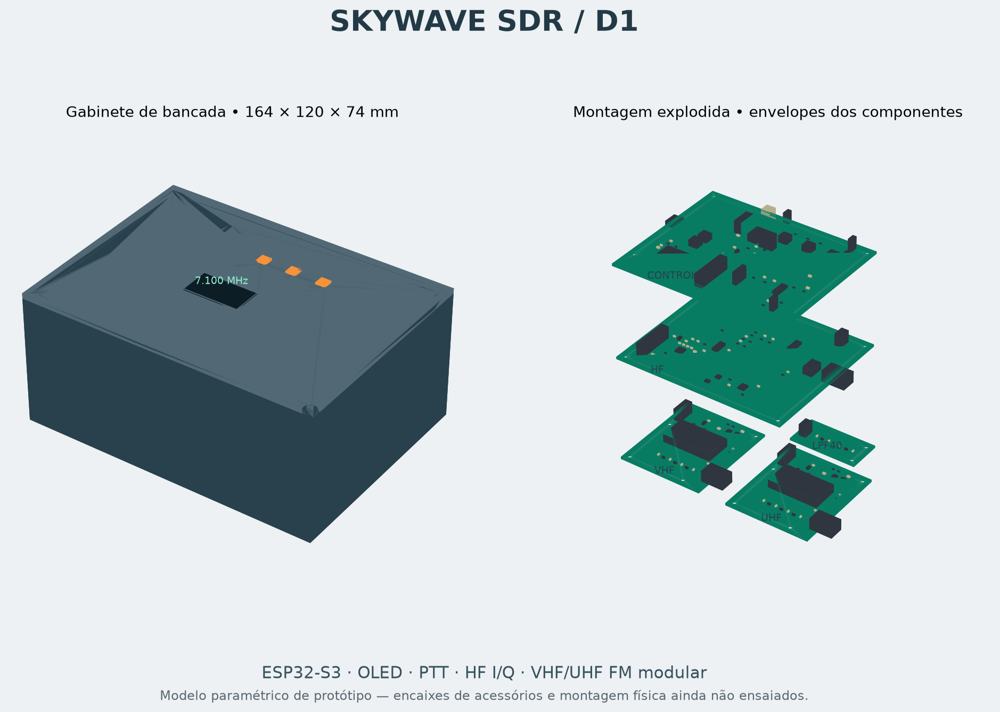

# SkyWave D1 — circuito, PCB e gabinete

Protótipo de engenharia de Daniel Marques. Os arquivos são editáveis; esta revisão
não é uma liberação para fabricação em série. Ensaios RF, térmicos e de montagem
física não foram realizados. O firmware continua sem backend RF e mantém TX bloqueado.

## Arquivos

- [Esquemas e placas KiCad](ecad): oito projetos, biblioteca local e roteamento.
- [BOM por referência](bom.csv) e [circuito com todas as conexões](design.json).
- [Fontes dos fabricantes](sources.json), com hashes quando o PDF foi obtido.
- [Montagem STEP](cad/skywave_d1_assembly.step), placas individuais, base e tampa em STEP/STL.
- [Simulações](reports/simulation.json), [ERC/DRC completos](reports/checks.json)
  e [verificação mecânica](reports/mechanical.json).
- [Curvas dos filtros](plots/filter_response.pdf) e [netlists ngspice](simulation).
- [Gerber e Excellon por placa](fabrication_prototype), exportados com o bloqueio de verificações ativo.

## Resultado das verificações — 12/10/2026

| Verificação executada | Resultado |
|---|---|
| KiCad ERC/DRC, 8 placas | Zero erros, zero avisos e zero conexões pendentes |
| 915 pads comparados ao circuito | Redes, números de pino, valores e posições conferem |
| 6 filtros em ngspice | Conferem com cálculo independente por matrizes ABCD |
| 1.800 casos de tolerância LC | Atendem às metas do modelo com Q=35; não são medições |
| Modelos STEP e interseções | Sólidos válidos, sem colisões entre placas ou contra base/tampa |
| Firmware | Duas variantes compiladas; testes nativos de controle passaram com UBSan |
| Contratos de artefatos | 4 testes Python passaram |

Hashes das placas e esquemas constam dos relatórios. Os testes digitais de PTT e
quadratura são verificações lógicas; não incluem atrasos reais dos componentes.
O resultado não valida o desempenho do rádio completo nem substitui bancada.

## Placas e componentes

| Placa | Dimensões | Circuito |
|---|---|---|
| Controle | 120 × 100 mm, 2 camadas | ESP32-S3-WROOM-1-N8, OLED I²C externo, USB4105, USBLC6-2SC6, LM1117, lógica de PTT, CD74HCT4052, LM386 |
| HF | 120 × 100 mm, 4 camadas | TLV320AIC3204, TLV75518, Si5351A, 74LVC74A, dois SN74CBT3253, dois TLV9064, relé G6K |
| VHF | 60 × 70 mm, 4 camadas | DRA818V, TPS62160, buffer UART e filtro de saída |
| UHF | 60 × 70 mm, 4 camadas | DRA818U, TPS62160, buffer UART e filtro de saída |
| Filtros HF | 48 × 24 mm cada, 4 camadas | Cartuchos LC de sete polos para 40/20/15/10 m, identificação resistiva |

HF usa conversão I/Q em recepção e transmissão. É um **excitador de baixo nível**,
sem PA. A potência e a supressão de imagem/portadora ainda precisam ser medidas.
Os DRA818 são módulos de voz FM controlados por UART; **não oferecem SDR I/Q aberto**.
H/L aterrado seleciona o modo nominal de 0,5 W, que não foi medido neste projeto.
Somente um módulo pode receber habilitação de transmissão por vez.

A BOM contém MPNs dos circuitos principais e famílias/especificações de parte dos
passivos. Ainda requer fechamento dos códigos de compra, preços e equivalentes.
Os indutores HF são Coilcraft 0805CS; a simulação com Q=35 não garante o Q real
desses componentes em cada frequência. Confirmar perdas e autorressonância na bancada.
O relatório também calcula a sensibilidade a Q=10/20/35/50. O indutor de potência
TDK VLS3015ET-2R2M está marcado NRND pelo fabricante; para a próxima revisão,
selecionar uma alternativa ativa e conferir novamente footprint, corrente e perdas.

## Energia, portas e conexões

**Entrada: 5 V regulados, fonte de pelo menos 2 A em J3 da placa de controle.**
J3.1 = +5 V; J3.2 = GND. Não há proteção contra inversão, carregador, bateria ou
power-path. USB-C nesta revisão leva **dados e referência VBUS para ESD**; não
alimenta o sistema. Nunca ligar célula de lítio diretamente a J3.

O LM1117 fornece 3,3 V. A dissipação estimada a 400 mA é 0,68 W; temperatura precisa
ser medida. Cada DRA tem buck de aproximadamente 4,02 V, nominalmente até 1 A.
O cálculo de consumo está em `reports/simulation.json`; não é autonomia medida.

| Interface do controle | Ligação |
|---|---|
| J1 PTT externo | 1 = PTT ativo em zero; 2 = GND; contato normalmente aberto |
| J2 OLED | 1 GND, 2 +3V3, 3 SCL, 4 SDA; verificar ordem no módulo comprado |
| J3 energia | 1 +5V, 2 GND |
| J4 USB-C | Console e programação; GPIO19 D− / GPIO20 D+ |
| J5 HF, 2×10 | Cabo pino a pino para J1 HF; máximo curto de bancada, ainda sem SI medida |
| J6 VHF / J7 UHF, 2×5 | Cabo pino a pino para J1 do módulo correspondente |
| J8 microfone | 1 sinal polarizado, 2 GND; cápsula eletreto externa |
| J9 alto-falante | 1 áudio desacoplado, 2 GND; 8 Ω |

As tabelas completas de pinos e redes estão em `design.json` e nos esquemas.
Orientar os cabos pelo pino 1, não pela posição visual dos conectores.
Os cartuchos HF usam cabo curto 2×3 para J2 HF; instalar somente um cartucho por vez.
Usam IDs de 1 kΩ, 2,2 kΩ, 4,7 kΩ e 10 kΩ. A leitura/validação pelo firmware está pendente.

PTT físico e GPIO38/TX_ARM passam por lógica AND/NAND e decodificador SN74HC139.
GPIO39/40 selecionam HF/VHF/UHF; valor 3 desabilita todos. GPIO41/42 controlam PD
dos DRA. Pull-down em TX_ARM mantém TX desabilitado durante reset; o firmware
mantém ARM, PD, reset do codec e reset da quadratura em zero nesta revisão.
Essa lógica não mede filtro, potência, VSWR ou temperatura.

## Limites do layout e da mecânica

O roteamento é um ponto de partida para revisão elétrica. ERC/DRC verificam regras
geométricas e conectividade; não demonstram integridade de sinal, impedância RF,
estabilidade do buck, USB ou desempenho do codec. Conferir os relatórios completos,
incluindo ligações pendentes e avisos, antes de qualquer pedido de placas.
O stackup precisa ser acordado com o fabricante; linhas RF de 50 Ω, par USB de
90 Ω, retorno de terra e desacoplamentos exigem revisão específica.

O gabinete de bancada mede **164 × 120 × 74 mm**, com paredes de 2,5 mm. É uma
primeira montagem modular, maior que o formato portátil final. As placas recebem
suportes internos; a tampa tem janela de display, três botões e ventilação.
Há acesso ao USB e passagens para PTT, energia e três SMA de painel com pigtails.
Conectores, speaker, microfone e cabos de painel ainda não têm montagem física validada.

Os STEP dos componentes usam envelopes derivados de footprints, não modelos
certificados de fabricante. A bandeja OLED assume módulo de 35,6 × 33,7 mm;
medir o módulo escolhido e ajustar `mechanical.py` antes de imprimir. Folgas de
impressão, curso dos botões, parafusos e volume de cabos precisam de ensaio.

## Reprodução

Os scripts originais estão em [`tools/hardware`](../../tools/hardware).
Dependências utilizadas: KiCad 7 para `pcbnew`, KiCad CLI 10.0.7 para ERC/DRC,
CadQuery 2.8.0, NumPy, Matplotlib, sexpdata, ngspice 42 e Freerouting 2.1.0/Java 21.
Os caminhos de ferramentas podem ser configurados por variáveis de ambiente;
os defaults refletem a estação de desenvolvimento.

1. `python tools/hardware/acquire.py`: obter referências públicas.
2. `python tools/hardware/ecad.py`: gerar esquemas e placas iniciais. **Sobrescreve roteamento.**
3. `python tools/hardware/route.py prepare`: preparar DSNs; executar Freerouting
   em cada DSN e salvar SES com o mesmo nome.
   Para HF, executar `hf_escape.py` antes do roteador: ele prepara escapes alternados
   dos encapsulamentos finos com vias de 0,5/0,25 mm.
4. `python tools/hardware/route.py finish`: importar trilhas/vias e preencher planos.
   Aplicar `refine.py` em HF/VHF/UHF para acabamento dos SMA, PTT e costura de terra.
5. `python tools/hardware/check.py`: executar ERC/DRC reais, sem apagar achados.
   `verify_pcb.py` confere os pads dos arquivos salvos contra o circuito.
   `cleanup.py <placas>` remove apenas stubs apontados pelo DRC; repetir a verificação
   após essa edição. Mudanças nas placas invalidam os hashes anteriores.
6. `python tools/hardware/analyze.py`: executar ngspice e tolerâncias dos filtros.
7. `python tools/hardware/mechanical.py` e `render.py`: gerar STEP/STL e imagem.

`export.py --manufacturing` só exporta Gerber/Excellon quando ERC/conectividade/DRC
passaram e o hash da placa confere com o relatório. A exportação continua marcada
como protótipo. Há uma regra explícita para os pads SMA de montagem na borda;
as demais regiões mantêm afastamento de 0,5 mm da borda. Vias em pads exigem
avaliação de montagem; esta revisão prioriza soldagem e inspeção de bancada.

Não foram fabricadas, energizadas ou testadas placas físicas durante esta revisão.
Próximos ensaios: fontes sem RF, OLED/USB/PTT, clock e codec, RX, depois TX em carga
de 50 Ω com analisador de espectro. Firmware DSP, drivers e sequência de T/R pendentes.

## Licenças

Arquivos originais: [MIT](../../LICENSE). Footprints copiados da biblioteca KiCad 7
mantêm [CC-BY-SA 4.0 com exceção KiCad](ecad/SkyWave.pretty/LICENSE.md); origem:
https://github.com/KiCad/kicad-footprints. A biblioteca foi copiada para tornar os
projetos independentes da versão instalada. DRA818 e VLS3015ET são footprints
originais deste projeto. Datasheets não são redistribuídos sob MIT.
O footprint MSOP-10 foi adaptado para herdar a regra de espaçamento de 0,15 mm
do projeto, em vez de impor o override de 0,20 mm da biblioteca original.
